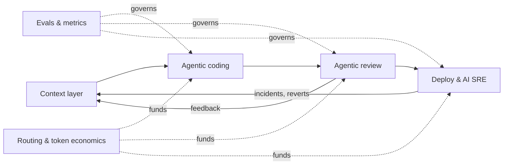
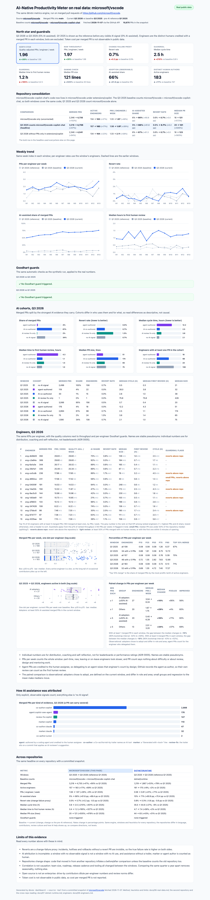
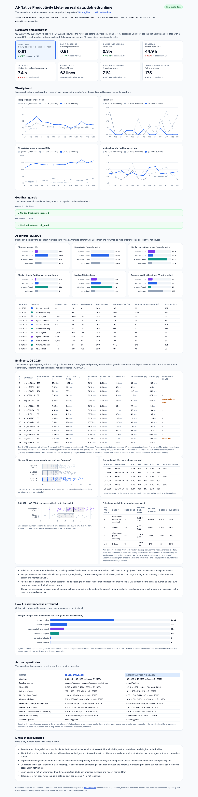
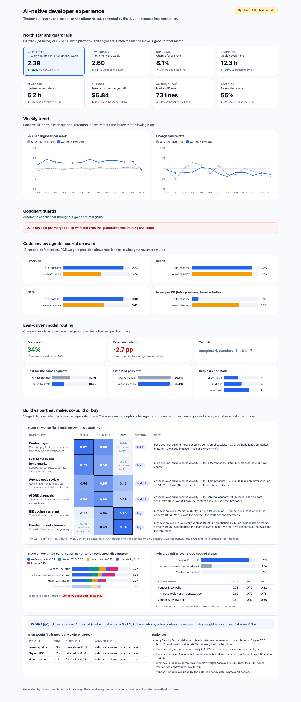

# AI-Native Productivity Meter

**A strategy and a working reference implementation for making a large engineering
organisation measurably faster with AI, without paying for it in quality, cost or
trust.**

**Read it as a site: [talktorobson.github.io/ai-native-meter](https://talktorobson.github.io/ai-native-meter/)**

Every CTO wants AI to multiply engineering throughput. Almost nobody has done it at
scale: even leading companies are far from AI writing most of their production code.
This repository makes the case for *why* it is worth solving, *why* it is still
unsolved, and *how* I would lead it, backed by small, tested code for the parts most
programmes get wrong: measurement, evals, context and cost.

> Context is the platform. Agents are applications. Evals are the governance.
> Routing is the economics.



## On real data: microsoft/vscode and dotnet/runtime

The same metrics engine, run on two famous public repositories with the same windows and
rules. Summary first, then each repository.

| Q3 2025 → Q3 2026 (year over year) | [microsoft/vscode](https://github.com/microsoft/vscode) | [dotnet/runtime](https://github.com/dotnet/runtime) |
|---|---|---|
| AI-assisted share of merged PRs | 5% → 66% | 10% → 71% |
| Merged PRs | 3,216 → 4,735 (+47%) | 1,219 → 1,867 (+53%) |
| PRs / engineer / week | 1.56 → 1.97 (+26%; +9% vs Q1 2025) | 0.58 → 0.81 (+41%; +71% vs Q1 2025) |
| Revert rate (change-failure proxy) | 0.5% → 0.7% | 0.8% → 0.3% |
| Median PR size | 20 → 121 lines | 44 → 63 lines |
| Goodhart guards | none fired | none fired |

Compare directions, not levels: the two codebases differ in language, contributors and review
culture. The full cross-repo reading is in
[07 · A second repository](docs/07-dotnet-runtime.md#what-differs-and-why).

### microsoft/vscode

**10,670 real merged pull requests** from
[**microsoft/vscode**](https://github.com/microsoft/vscode). The headline compares Q3 2026 with
the same quarter a year earlier, Q3 2025, which controls for seasonality. Q1 2025, with no
visible AI signal at all, stays on every chart as the pre-AI reference. The Copilot Chat code
moved into vscode in 2026 from
[microsoft/vscode-copilot-chat](https://github.com/microsoft/vscode-copilot-chat), so the
Q3 2025 baseline counts both repositories (like for like).

[](docs/dashboard-real.html)

- **AI-assisted share 5% → 66%** of merged PRs year over year (0% in Q1 2025): Copilot
  co-author trailers, the Copilot coding agent, Claude and Cursor trailers or markers.
- **PRs per engineer per week +26% year over year, but only +9% against the pre-AI
  reference.** Q3 2025 was the weakest quarter per engineer (1.56 vs 1.80 in Q1 2025), so
  quote both. Merged PRs +47%, engineers +17%. Counting vscode alone gave +102% and +48%, an
  overstatement corrected in [Repository consolidation](docs/06-real-data.md#repository-consolidation).
- **Revert rate flat** (0.5% → 0.7%), and AI co-authored PRs revert no more than the rest.
- **Review is the new bottleneck**: median PR size 20 → 121 lines, time to first human
  review 0.4 h → 1.2 h, and PRs with no AI signal grew and slowed too. No Goodhart guard fired.

Reverts are only a change-failure proxy, attribution is incomplete, open source is not an
enterprise, and none of this is causal. Method, heuristics and limits are in
[06 · Real data](docs/06-real-data.md); the snapshot is committed, so it all runs offline.

### dotnet/runtime

**4,325 real merged pull requests** from [**dotnet/runtime**](https://github.com/dotnet/runtime),
the .NET runtime and libraries: a large C# and C++ codebase with a strict review culture and
a public Copilot coding-agent rollout. Same windows, `main` only, dotnet's bots excluded.
No repository moved in between the windows (checked in
[07](docs/07-dotnet-runtime.md#repository-consolidation-check)), so the baseline is
dotnet/runtime alone.

[](docs/dashboard-real-dotnet-runtime.html)

- **AI-assisted share 10% → 71%**, with a different signature from vscode: the Copilot coding
  agent authors 13% of merged PRs (234, each credited to the human assignee), against about 4%
  on vscode.
- **PRs per engineer per week +41% year over year and +71% against Q1 2025**, with headcount
  nearly flat (+9%). Unlike vscode, the baseline is not soft.
- **Revert rate 0.8% → 0.3%** (10 reverted PRs, then 5): no degradation, too few to claim an
  improvement.
- **Review held its shape**: PRs grew modestly (44 → 63 lines); cycle time and first review
  rose year over year but are flat against Q1 2025. Agent PRs take longest to land (median
  61 h). No Goodhart guard fired.

### Engineers, under pseudonyms

Take the engineers who merged in both Q3 2025 and Q3 2026 and split them by AI adoption
(at least half their Q3 2026 PRs AI-assisted):

- **On dotnet/runtime, the typical adopter's output rose 89%, against 0% for the others.**
  The 90% interval of the gap is +27% to +200%.
- **On vscode, the median adopter gained no more than the others** (gap -19%, interval
  spanning zero), but pooled adopter output rose 95%. The gain sits with a few prolific
  engineers, and the top 10% merge 71% of PRs.

Each dashboard ranks engineers by KPI with per-engineer guardrails (small PRs, reverts above
the repository's, light review). Names are stable pseudonyms, because individual numbers are
for distribution and coaching, not leaderboards
([ADR-0005](docs/adr/0005-individual-metrics-are-not-leaderboards.md)). Details are in
[08 · Engineers](docs/08-engineers.md).

### And the target state, on synthetic data

[](docs/dashboard.html)

*The KPI dashboard generated by `devex dashboard` (synthetic, illustrative data), including
what public data cannot show: token cost, evals and routing. Open
[`docs/dashboard.html`](docs/dashboard.html) locally, or
[online](https://talktorobson.github.io/ai-native-meter/dashboard.html), for the interactive version.*

## Read the case

| # | Document | In one line |
|---|---|---|
| 01 | [The case](docs/01-the-case.md) | A ~USD 100M/year prize at 3,500 engineers, and six reasons it is still unsolved |
| 02 | [Metrics](docs/02-metrics.md) | One north star, four guardrails, automatic Goodhart guards |
| 03 | [Architecture](docs/03-architecture.md) | Context layer, agentic coding, agentic review, AI SRE, routing, platform |
| 04 | [Operating model](docs/04-operating-model.md) | Turning borrowed, part-time contributors into a dedicated team, and the first 90 days |
| 05 | [Build vs partner](docs/05-build-vs-partner.md) | Two-stage make / co-build / buy engine: motion fit, evidence-discounted scoring, priced lock-in, win probability and flip points |
| 06 | [Real data](docs/06-real-data.md) | The same metrics on 10,670 PRs from microsoft/vscode and its absorbed vscode-copilot-chat across three quarters: method, AI-attribution heuristics, repository consolidation, results and limits |
| 07 | [A second repository](docs/07-dotnet-runtime.md) | The same metrics on 4,325 PRs from dotnet/runtime, a consolidation check, and both repositories side by side: what differs and why |
| 08 | [Engineers](docs/08-engineers.md) | Per-engineer KPIs under pseudonyms: output distribution, guardrail flags, and AI adopters vs others a year apart |
| ADR | [Decisions](docs/adr) | Context before agents · precision before recall · route by evals · decisions as data · no leaderboards |

## Run the reference implementation

Pure Python 3.11+, no runtime dependencies.

```bash
python -m venv .venv && source .venv/bin/activate
pip install -e ".[dev]"
pytest -q          # 283 tests, offline
devex demo         # every module, printed as Markdown
devex dashboard    # the same numbers as a static HTML page: docs/dashboard.html
open docs/dashboard.html   # macOS; use xdg-open on Linux

devex report --source real                       # real microsoft/vscode PRs, from the committed snapshot
devex report --source real --repo dotnet/runtime # the second example
devex compare                                    # both repositories side by side
devex engineers --repo dotnet/runtime            # per-engineer KPIs, ranks and guardrails, pseudonymised
devex dashboard --source real                    # docs/dashboard-real*.html, one page per repository
```

| Command | Module | What it shows |
|---|---|---|
| `devex dashboard [--out PATH]` | [`dashboard.py`](src/devex/dashboard.py) | Self-contained HTML (inline CSS and SVG, no external assets) with KPI tiles, weekly trends, guards, evals, routing, the motion-fit map, contribution breakdown and win probabilities |
| `devex report` | [`metrics.py`](src/devex/metrics.py) | Baseline vs rollout scorecard with Goodhart guards |
| `devex fetch --repo OWNER/NAME --since DATE --until DATE [--into OWNER/NAME --moved-to PATH]` | [`github_source.py`](src/devex/github_source.py) | Real merged PRs from a public GitHub repo via `gh api graphql`, mapped to the same model and saved as an offline snapshot in `data/real/`; `--into` adds a predecessor repository whose code moved into the snapshot's repo, so that window's baseline is like for like |
| `devex report --source real [--repo OWNER/NAME ...]`, `devex dashboard --source real` | [`real.py`](src/devex/real.py), [`dashboard_real.py`](src/devex/dashboard_real.py) | The scorecard, AI cohorts, attribution evidence and Goodhart guards on a snapshot (microsoft/vscode by default; repeat `--repo` for several); one dashboard page per committed snapshot, `docs/dashboard-real.html` for vscode and `docs/dashboard-real-OWNER-NAME.html` for the others. Current defaults to the latest window, baseline to the same quarter a year earlier; override with `--baseline DATE` / `--current DATE` |
| `devex compare [--repo OWNER/NAME ...]` | [`real.py`](src/devex/real.py) | The real-data headline of every committed snapshot (or the ones named) side by side |
| `devex engineers [--repo OWNER/NAME ...] [--window current\|baseline\|reference] [--sort KPI] [--top N] [--min-prs N] [--logins]` | [`engineers.py`](src/devex/engineers.py), [`dashboard_engineers.py`](src/devex/dashboard_engineers.py) | Per-engineer KPIs with a rank each, guardrail flags, output percentiles and the paired AI-adopter comparison, under stable pseudonyms; `--logins` reveals real logins for local use only |
| `devex eval-review` | [`review_eval.py`](src/devex/review_eval.py) | Any review agent scored on a seeded-defect fintech benchmark |
| `devex context` | [`context.py`](src/devex/context.py) | Curation-aware graph retrieval under a token budget, plus curation lint |
| `devex route` | [`routing.py`](src/devex/routing.py) | Eval-driven model routing: savings and quality trade-off |
| `devex decide [--memo] [--weight NAME=VALUE]` | [`motion_fit.py`](src/devex/motion_fit.py), [`vendor_scorecard.py`](src/devex/vendor_scorecard.py), [`robustness.py`](src/devex/robustness.py), [`decision.py`](src/devex/decision.py) | Make / co-build / buy: motion fit per capability, evidence-discounted scores, P(win), flip points, and an ADR-style memo with `--memo` |

Highlights from [`docs/demo-output.md`](docs/demo-output.md) (synthetic data):

- Throughput **+31%** with change failure rate **down** and review latency **−55%**,
  yet the cost guard fires: token cost per merged PR **+125%**. That is the month-two
  conversation a platform leader should start, not discover.
- A precise rule baseline beats a noisy reviewer with the *same recall*
  (F0.5 0.90 vs 0.61), because noise is what gets reviewers muted.
- Retrieval pulls the ticket, the incident and the governing ADR into context, and
  keeps the deprecated design doc out.
- Eval-driven routing cuts cost **34%** and states the expected quality cost next to it.
- Make / co-build / buy is decided in two stages: the context layer is a **build**, the
  IDE assistant a **buy**, code review a **co-build**. For code review, the best raw
  scorer is gated out, demo claims are discounted, and the co-build wins **82%** of
  2,000 simulations, robust unless the review-quality weight rises above 0.54.

## What this demonstrates

| Capability | Evidence here |
|---|---|
| AI developer-tooling strategy at scale | [The case](docs/01-the-case.md), [architecture](docs/03-architecture.md) |
| Evaluation rigour replacing subjective judgment | `review_eval.py`, `routing.py`, [ADR-0002](docs/adr/0002-precision-over-recall-in-review.md), [ADR-0003](docs/adr/0003-route-by-evals.md) |
| Context and retrieval infrastructure | `context.py`, [ADR-0001](docs/adr/0001-context-before-agents.md) |
| Productivity measurement that resists gaming | `metrics.py`, `engineers.py`, [metrics](docs/02-metrics.md), [ADR-0005](docs/adr/0005-individual-metrics-are-not-leaderboards.md) |
| Token-cost management | Cost per merged PR guardrail, routing simulator |
| Vendor partnerships and lock-in management | `motion_fit.py`, `vendor_scorecard.py`, `robustness.py`, `decision.py`, [build vs partner](docs/05-build-vs-partner.md), [ADR-0004](docs/adr/0004-decisions-as-data.md) |
| Building teams from fragmented resourcing | [Operating model](docs/04-operating-model.md) |
| Regulated, risk-aware delivery | Fintech defect categories, sandbox defaults, staged AI SRE autonomy |

## Honest limits

- The synthetic dashboard and demo are illustrative; they are there to make the
  reasoning checkable, not to claim results.
- The real-data view uses public proxies: reverts stand in for change failures, AI
  assistance counts only when it leaves a trace (agent author, trailer, marker, label),
  token cost is not observable, and an open-source project is not an enterprise. It shows
  correlation across three quarters, not causation; comparing the same quarter a year apart
  removes seasonality, nothing else. Repositories change shape: vscode absorbed
  vscode-copilot-chat, and a vscode-only comparison nearly doubled the apparent gain until the
  baseline counted both. Two repositories are better than one, but still not a sample: see
  [06 · Real data](docs/06-real-data.md) and [07 · A second repository](docs/07-dotnet-runtime.md).
- The engineer view is observational. AI adopters chose to adopt, groups are 10 to 51 people,
  delegating to an agent raises an engineer's PR count by design, and PRs per week ignores
  review, design and mentoring work. Pseudonyms are a convention, not anonymity: see
  [08 · Engineers](docs/08-engineers.md).
- The retrieval scorer is lexical plus graph traversal. A production system adds
  embeddings and a learned re-ranker; the contract (provenance, curation weighting,
  budgets) is what this code is meant to show.
- The reviewers included are baselines. Real LLM reviewers plug in through the same
  `Callable[[ReviewCase], Sequence[Finding]]` interface.

## About

Written by [Robson Reis](https://github.com/talktorobson).

<!-- Add 3-4 lines on your own experience leading AI developer tooling here. -->

MIT licensed.
