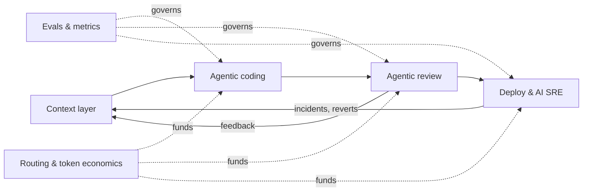

# AI-native developer experience

**A strategy and a working reference implementation for making a large engineering
organisation measurably faster with AI, without paying for it in quality, cost or
trust.**

Every CTO wants AI to multiply engineering throughput. Almost nobody has done it at
scale: even leading companies are far from AI writing most of their production code.
This repository makes the case for *why* it is worth solving, *why* it is still
unsolved, and *how* I would lead it, backed by small, tested code for the parts most
programmes get wrong: measurement, evals, context and cost.

> Context is the platform. Agents are applications. Evals are the governance.
> Routing is the economics.

[](docs/dashboard.html)

*The KPI dashboard generated by `devex dashboard` (synthetic, illustrative data).
Open [`docs/dashboard.html`](docs/dashboard.html) locally for the interactive version.*



## Read the case

| # | Document | In one line |
|---|---|---|
| 01 | [The case](docs/01-the-case.md) | A ~USD 100M/year prize at 3,500 engineers, and six reasons it is still unsolved |
| 02 | [Metrics](docs/02-metrics.md) | One north star, four guardrails, automatic Goodhart guards |
| 03 | [Architecture](docs/03-architecture.md) | Context layer, agentic coding, agentic review, AI SRE, routing, platform |
| 04 | [Operating model](docs/04-operating-model.md) | Turning borrowed, part-time contributors into a dedicated team, and the first 90 days |
| 05 | [Build vs partner](docs/05-build-vs-partner.md) | Two-stage make / co-build / buy engine: motion fit, evidence-discounted scoring, priced lock-in, win probability and flip points |
| ADR | [Decisions](docs/adr) | Context before agents · precision before recall · route by evals · decisions as data |

## Run the reference implementation

Pure Python 3.11+, no runtime dependencies.

```bash
python -m venv .venv && source .venv/bin/activate
pip install -e ".[dev]"
pytest -q          # 116 tests
devex demo         # every module, printed as Markdown
devex dashboard    # the same numbers as a static HTML page: docs/dashboard.html
open docs/dashboard.html   # macOS; use xdg-open on Linux
```

| Command | Module | What it shows |
|---|---|---|
| `devex dashboard [--out PATH]` | [`dashboard.py`](src/devex/dashboard.py) | Self-contained HTML (inline CSS and SVG, no external assets) with KPI tiles, weekly trends, guards, evals, routing, the motion-fit map, contribution breakdown and win probabilities |
| `devex report` | [`metrics.py`](src/devex/metrics.py) | Baseline vs rollout scorecard with Goodhart guards |
| `devex eval-review` | [`review_eval.py`](src/devex/review_eval.py) | Any review agent scored on a seeded-defect fintech benchmark |
| `devex context` | [`context.py`](src/devex/context.py) | Curation-aware graph retrieval under a token budget, plus curation lint |
| `devex route` | [`routing.py`](src/devex/routing.py) | Eval-driven model routing: savings and quality trade-off |
| `devex decide [--memo] [--weight NAME=VALUE]` | [`motion_fit.py`](src/devex/motion_fit.py), [`vendor_scorecard.py`](src/devex/vendor_scorecard.py), [`robustness.py`](src/devex/robustness.py), [`decision.py`](src/devex/decision.py) | Make / co-build / buy: motion fit per capability, evidence-discounted scores, P(win), flip points, and an ADR-style memo with `--memo` |

Highlights from [`docs/demo-output.md`](docs/demo-output.md) (synthetic data):

- Throughput **+31%** with change failure rate **down** and review latency **−55%**,
  yet the cost guard fires: token cost per merged PR **+125%**. That is the month-two
  conversation a platform leader should start, not discover.
- A precise rule baseline beats a noisy reviewer with the *same recall*
  (F0.5 0.90 vs 0.61), because noise is what gets reviewers muted.
- Retrieval pulls the ticket, the incident and the governing ADR into context, and
  keeps the deprecated design doc out.
- Eval-driven routing cuts cost **34%** and states the expected quality cost next to it.
- Make / co-build / buy is decided in two stages: the context layer is a **build**, the
  IDE assistant a **buy**, code review a **co-build**. For code review, the best raw
  scorer is gated out, demo claims are discounted, and the co-build wins **82%** of
  2,000 simulations, robust unless the review-quality weight rises above 0.54.

## What this demonstrates

| Capability | Evidence here |
|---|---|
| AI developer-tooling strategy at scale | [The case](docs/01-the-case.md), [architecture](docs/03-architecture.md) |
| Evaluation rigour replacing subjective judgment | `review_eval.py`, `routing.py`, [ADR-0002](docs/adr/0002-precision-over-recall-in-review.md), [ADR-0003](docs/adr/0003-route-by-evals.md) |
| Context and retrieval infrastructure | `context.py`, [ADR-0001](docs/adr/0001-context-before-agents.md) |
| Productivity measurement that resists gaming | `metrics.py`, [metrics](docs/02-metrics.md) |
| Token-cost management | Cost per merged PR guardrail, routing simulator |
| Vendor partnerships and lock-in management | `motion_fit.py`, `vendor_scorecard.py`, `robustness.py`, `decision.py`, [build vs partner](docs/05-build-vs-partner.md), [ADR-0004](docs/adr/0004-decisions-as-data.md) |
| Building teams from fragmented resourcing | [Operating model](docs/04-operating-model.md) |
| Regulated, risk-aware delivery | Fintech defect categories, sandbox defaults, staged AI SRE autonomy |

## Honest limits

- All data is synthetic and all numbers are illustrative; they are there to make the
  reasoning checkable, not to claim results.
- The retrieval scorer is lexical plus graph traversal. A production system adds
  embeddings and a learned re-ranker; the contract (provenance, curation weighting,
  budgets) is what this code is meant to show.
- The reviewers included are baselines. Real LLM reviewers plug in through the same
  `Callable[[ReviewCase], Sequence[Finding]]` interface.

## About

Written by [Robson Reis](https://github.com/talktorobson).

<!-- Add 3-4 lines on your own experience leading AI developer tooling here. -->

MIT licensed.
