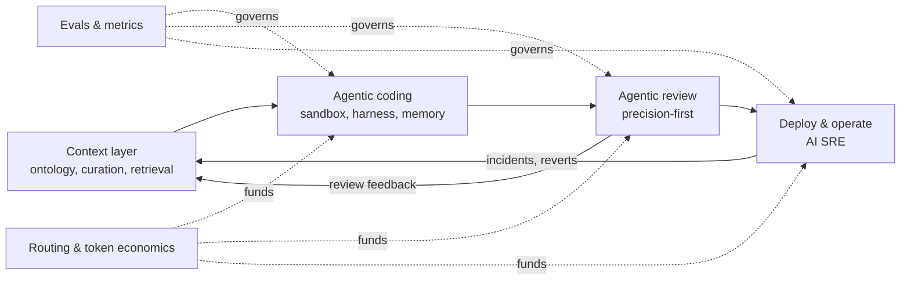

# 01 · The case: why everyone wants to solve this, and why almost nobody has

> Numbers in this document are **illustrative assumptions** for a 3,500-engineer
> organisation, stated so they can be challenged and replaced with real data.

## The prize is enormous

| Lever | Assumption | Annual value |
|---|---|---|
| Engineering capacity | 3,500 engineers at a blended USD 120k fully loaded | USD 420M of payroll |
| Throughput | +25% quality-adjusted merged PRs per engineer-week | ~875 engineer-equivalents, ~USD 105M of capacity |
| Quality | 1 pp lower change failure rate on ~336k PRs/year | ~3,400 fewer failed changes, incidents and rollbacks |
| AI spend | Agentic usage at USD 300–1,000 per engineer per month | USD 12–42M per year, growing |
| Token efficiency | 30% saved through routing, caching and context packing | USD 4–13M per year |

No other investment an engineering organisation can make has this shape: a
double-digit capacity gain on its largest cost line. That is why every CTO wants it.

## Why it is still unsolved

Even the most advanced peers are far from AI writing most of their production code.
The gap is not model intelligence. It is six structural problems:

1. **Context is the binding constraint.** Agents fail on what is not in the prompt:
   internal libraries, conventions, ownership, the ADR that forbids the obvious
   solution, the incident that explains the odd check. Public benchmarks do not
   measure this because public repositories do not have it.
2. **Amdahl's law applies to the SDLC.** Authoring is a minority of lead time.
   Speed up authoring alone and the queue moves to review, CI, approvals and deploys.
   Worse, a flood of AI-authored PRs raises the change failure rate if review does
   not scale with it.
3. **Measurement is missing infrastructure.** Without organisation-specific evals,
   every decision (which vendor, which model, which prompt) is an opinion backed by
   a demo. Teams cannot tell a real improvement from a novelty effect.
4. **Cost scales faster than value by default.** An agentic loop consumes 10–100×
   the tokens of a chat turn. Without routing, caching and budgets, spend grows with
   adoption while value grows with *accepted* output.
5. **Trust is fragile in regulated environments.** One leaked secret, one agent with
   production credentials or one unexplained change in a money-moving path can freeze
   the programme. Sandboxing, data residency and audit trails are prerequisites.
6. **It is an organisational problem wearing a technical costume.** Work is often
   carried by borrowed, part-time contributors with unclear boundaries between
   pillars, and adoption is a change-management problem, not a rollout.

## The thesis

> **Context is the platform. Agents are applications. Evals are the governance.
> Routing is the economics.**

It is a flywheel: better context produces better agent output; more accepted PRs
produce more signals (review comments, reverts, incidents); those signals are curated
back into context and into the eval sets. The organisation that closes this loop
first compounds; the one that buys point tools does not.

## What "winning" looks like after 12 months (illustrative targets)

| Metric | Baseline | Target | Guardrail |
|---|---|---|---|
| Quality-adjusted merged PRs / engineer / week | 2.0 | 2.5 (+25%) | Median PR size within ±30% |
| Change failure rate | measured | −1 pp | Never worse than baseline for 2 weeks running |
| Median review latency | measured | −50% | Human approval stays mandatory on high-risk paths |
| Token cost per merged PR | measured | flat or down while usage grows | Monthly budget per team |
| Agent-authored share of merged lines | measured | tracked, not targeted | Reported, never incentivised |

The last row matters: **AI-authored share is a diagnostic, not a goal.** Targeting it
invites the wrong behaviour. The goal is shipped, working software per engineer.

## What makes this credible

The [reference implementation](https://github.com/talktorobson/ai-native-devex/tree/main/src/devex) is deliberately small, but every
claim above maps to running, tested code: the scorecard and Goodhart guards, the
seeded-defect review eval, curation-aware retrieval, eval-driven model routing and
the build-vs-partner scorecard. See [`demo-output.md`](demo-output.md).
