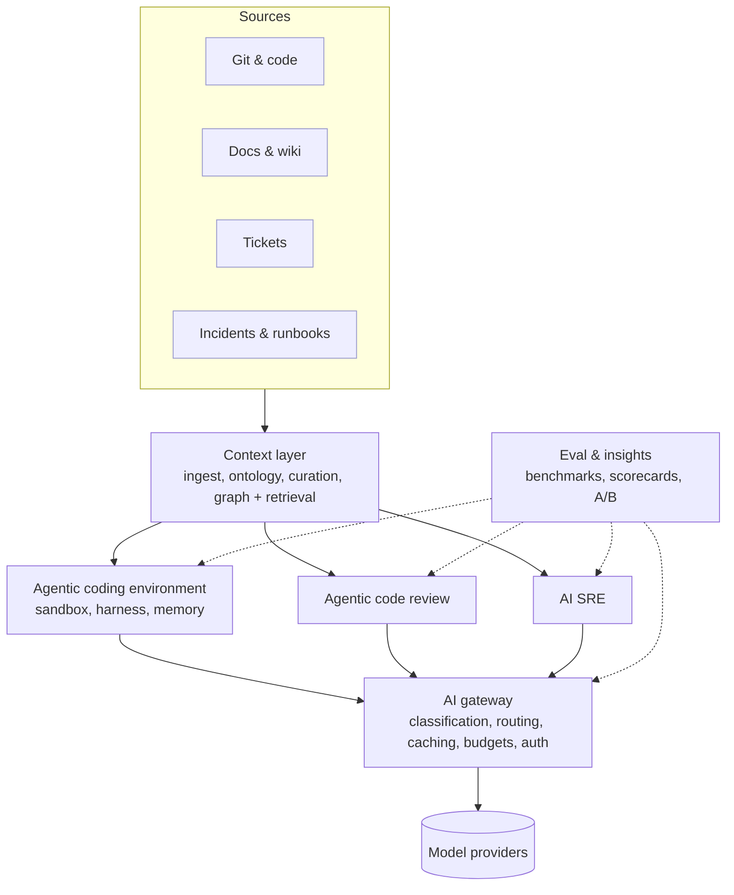

# 03 · Architecture: six workstreams, one platform

Each workstream below lists the problem, the design stance, the first milestone and the
metric it moves.

## 1. Context layer (highest priority)

**Problem.** Agents and reviewers are only as good as the context they receive, and
enterprise knowledge is scattered, stale, contradictory and ownerless.

**Design stance** (reference: [`context.py`](../src/devex/context.py)):

- **Ontology first.** A small set of entity kinds (service, repo, API, doc, runbook,
  ADR, ticket, incident, team) and typed relations (`owns`, `depends_on`, `governs`,
  `affected`, `follows_up`). Start with ten kinds, not a hundred.
- **Curation standards as code.** Every entity has an owner, a source and a freshness
  SLA. `lint()` reports missing owners, stale content, orphans and deprecated
  documents that are still linked. Lint results are published per team.
- **Curation-aware retrieval.** Deprecated content never reaches a prompt; stale
  content is down-weighted; graph traversal brings in what lexical or vector search
  misses (the ADR that governs the API the ticket touches).
- **Provenance in every prompt.** Each context item carries `source`, `owner`,
  `updated` and *why it was picked*, so failures are debuggable and owners get
  actionable feedback.
- **Event-driven updates.** Webhooks from VCS, wiki and ticketing re-index changed
  entities; nightly jobs recompute freshness and lint.
- **Token budgets.** Retrieval packs to a budget. More context is not better
  context.

**First milestone.** Three pilot domains with an ontology, owners assigned for 90% of
entities, and a retrieval eval set of 200 real questions with known answers.

**Metric.** Retrieval recall@budget on the eval set; downstream agent task success
with and without the context layer.

## 2. Agentic coding environment

**Problem.** Agents need to run code to be useful, and running code is where the risk
is.

**Design stance.**

- **Sandbox by default.** Ephemeral, isolated environments per task; no production
  credentials; egress allow-list; per-task short-lived identity; full audit log.
- **Harness, not chat.** Task spec → plan → edit → build/test → self-review → PR,
  with deterministic tool interfaces (MCP) so tools are swappable and testable.
- **Memory with hygiene.** Repository conventions and review feedback are stored as
  curated context entities, with the same ownership and freshness rules.
- **Prompt CI.** System prompts are versioned artefacts. A change ships only if it
  improves the coding eval suite without regressing cost.

**First milestone.** Hosted environment for two languages/build systems with a
task-success eval built from 100 historical tickets with their merged PRs as oracles.

**Metric.** Agent task success rate, accepted-PR rate, cost per accepted PR.

## 3. Agentic code review

**Problem.** AI-authored PR volume moves the bottleneck to review and threatens the
change failure rate.

**Design stance** (reference: [`review_eval.py`](../src/devex/review_eval.py),
[ADR-0002](adr/0002-precision-over-recall-in-review.md)):

- **Layered review.** Deterministic linters and SAST first, AI reviewer second, humans
  last, each catching what the previous layer cannot.
- **Precision before recall.** Score candidates on F0.5, noise per PR and silence on
  clean PRs. A noisy reviewer gets muted and then catches nothing.
- **Risk-based depth.** Money movement, auth and PII paths get the deepest review and
  mandatory human approval; low-risk changes get faster paths.
- **Seeded-defect benchmark.** A private benchmark of real defects (from reverts and
  incidents) injected into real diffs, refreshed quarterly.

**First milestone.** Shadow mode on five repositories: the AI reviewer comments
privately; humans label usefulness; go live only above a precision bar.

**Metric.** Comment acceptance rate, defect escape rate, review latency, CFR.

## 4. AI SRE

**Problem.** Incident detection, diagnosis and remediation are expensive and
knowledge-heavy, which makes them ideal for AI and dangerous to automate naively.

**Design stance: staged autonomy.**

| Level | Agent does | Human does | Gate to next level |
|---|---|---|---|
| L0 | Summarises alerts and timelines | Everything else | Summary usefulness ≥ 80% |
| L1 | Proposes probable cause with evidence | Confirms | Top-3 cause accuracy on replayed incidents |
| L2 | Proposes remediation from runbooks | Approves and executes | Zero unsafe proposals over N incidents |
| L3 | Executes pre-approved reversible actions | Supervises | Rollback rate, audit review |
| L4 | Closes the loop for known classes | Reviews post hoc | Executive risk sign-off |

**First milestone.** Replay harness over the last 50 incidents to score vendor and
in-house diagnosis on the same evidence.

**Metric.** Time to diagnosis, MTTR, on-call pages per engineer.

## 5. Prompt classification, model routing and token economics

**Problem.** Sending every request to the frontier model is the easiest way to make AI
spend grow faster than value.

**Design stance** (reference: [`routing.py`](../src/devex/routing.py),
[ADR-0003](adr/0003-route-by-evals.md)):

- Classify each request (trivial / standard / complex) from cheap signals.
- Route to the **cheapest model whose measured pass rate on that class clears the
  bar**. Quality numbers come from internal evals, not vendor charts.
- Report the expected quality trade-off next to the savings; never hide it.
- Prompt caching and context de-duplication at the gateway; per-team budgets and
  showback.

**Metric.** Token cost per merged PR, cache hit rate, quality delta vs always-frontier.

## 6. AI enablement platform (later)

Gateway, authentication, model marketplace and plugin distribution become the paved
road every workstream ships through. It folds in once the workstreams above have
stable interfaces, not before.
