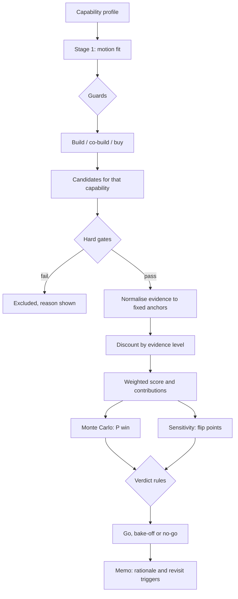

# 05 · Build vs partner: decisions as data

Implemented in [`motion_fit.py`](https://github.com/talktorobson/ai-native-devex/blob/main/src/devex/motion_fit.py) (Stage 1),
[`vendor_scorecard.py`](https://github.com/talktorobson/ai-native-devex/blob/main/src/devex/vendor_scorecard.py) (Stage 2),
[`robustness.py`](https://github.com/talktorobson/ai-native-devex/blob/main/src/devex/robustness.py) (Monte Carlo and sensitivity) and
[`decision.py`](https://github.com/talktorobson/ai-native-devex/blob/main/src/devex/decision.py) (verdict, rationale and memo). Run it with
`devex decide`, `devex decide --memo` or `devex decide --weight review_quality=0.5`.
Decision record: [ADR-0004](adr/0004-decisions-as-data.md).

> All capabilities, vendors, prices and scores are **synthetic and illustrative**. Every
> vendor is fictional. The numbers show the method, not a market.

## Why an engine at all

A make-or-buy call for an AI capability is usually decided by the best demo and the most
senior opinion in the room. Both are poor predictors. The engine is built on three rules:

1. **Separate *whether* to own a capability from *which* option to pick.** Most bad
   sourcing decisions answer the second question before the first.
2. **Score evidence, not claims.** A vendor demo and a measured result on our own
   benchmark must not count the same.
3. **Report how fragile the answer is.** A verdict that flips with a 5% change in one
   weight is a bake-off, not a decision.

Principle behind every default: **own the context, the evals and the interfaces; rent
the rest.** Whoever owns those three can swap any vendor within a quarter.

## The pipeline

## Stage 1 · Motion fit: should we own this capability?

Each capability is profiled on seven 0–1 attributes, agreed in a sourcing review:

| Attribute | High means | Pushes towards |
|---|---|---|
| differentiation | It is part of how we win | build |
| proprietary_context | It runs on our code, history and conventions | build, co-build |
| market_maturity | Several good products already exist | buy |
| market_velocity | The frontier moves faster than a team could follow | co-build, buy |
| data_sensitivity | Regulated or residency-constrained data | build |
| internal_capacity | A team exists that could own it | build |
| time_pressure | Value is needed this half | buy, co-build |

**Mechanics.** Each motion $m$ has a signed affinity per attribute, with
$\sum_i |\alpha_{m,i}| = 1$:

$$\text{fit}(m) = 0.5 + \sum_i \alpha_{m,i}\,(a_i - 0.5)$$

A neutral profile (all attributes 0.5) scores 0.5 for every motion. Because the absolute
affinities sum to 1, fit stays in [0, 1]. Each term $\alpha_{m,i}(a_i-0.5)$ is that
attribute's **contribution**. The rationale is the difference in contributions between
the winning motion and the runner-up.

**Guards** veto a motion whatever its fit:

- *buy* is blocked when proprietary_context ≥ 0.85, because the capability **is** our context.
- *build* is blocked when internal_capacity < 0.2, because there is no team to own it.

Output of `devex decide`, Stage 1:

| Capability | Build | Co-build | Buy | Recommended | Why |
|---|---|---|---|---|---|
| Context layer | **0.82** | 0.68 | ~~0.20~~ | **build** | build over co-build: differentiation +0.06, internal capacity +0.06; co-build leads on market maturity +0.01; buy blocked (it is our own context). |
| Eval harness and benchmarks | **0.73** | 0.58 | ~~0.28~~ | **build** | build over co-build: market velocity +0.06, differentiation +0.05; buy blocked (it is our own context). |
| Agentic code review | 0.56 | **0.65** | 0.46 | **co-build** | co-build over build: market velocity +0.09, time pressure +0.01; build leads on differentiation +0.01. We still own the context, the evals and the interfaces. |
| AI SRE diagnosis | 0.58 | **0.68** | 0.39 | **co-build** | co-build over build: market velocity +0.06, internal capacity +0.05; build leads on data sensitivity +0.01. We still own the context, the evals and the interfaces. |
| IDE coding assistant | 0.22 | 0.50 | **0.80** | **buy** | buy over co-build: market maturity +0.14, differentiation +0.10; co-build leads on market velocity +0.04. We still own the context, the evals and the interfaces. |
| Frontier model inference | ~~0.15~~ | 0.49 | **0.84** | **buy** | buy over co-build: proprietary context +0.20, differentiation +0.12; co-build leads on market velocity +0.05; build blocked (no team to own a build). We still own the context, the evals and the interfaces. |

**Worked example: agentic code review.** Build and co-build both gain +0.06 from
proprietary context (0.75). Market velocity (0.8) is where they part: +0.06 for co-build
and −0.03 for build. Co-build wins by 0.09 on that attribute alone. Read it as: our
context matters, but the model frontier moves faster than one internal team, so partner
for the engine and keep the context and evals in-house.

## Stage 2 · Candidate scoring with evidence, not opinions

### 1. Hard gates first

Data residency, security certification, no training on customer code, and audit logging.
A failed gate excludes a candidate however well it scores. The reason is shown, and the
candidate is never ranked, simulated or allowed to win.

### 2. Normalise raw evidence against fixed anchors

| Criterion | Raw evidence | Normalisation |
|---|---|---|
| review quality | F0.5 on the seeded-defect benchmark ([review_eval](https://github.com/talktorobson/ai-native-devex/blob/main/src/devex/review_eval.py)); the in-house option is **measured live** | as is |
| 3-year TCO | TCO model below | linear, \$1.5M → 1, \$5M → 0 |
| time to value | weeks to production | linear, 4 wk → 1, 40 wk → 0 |
| operability | 0–1 rubric: SLOs, on-call, audit trails | as is |
| lock-in | priced exit risk (below) | 1 − risk |

$$\text{linear}(x) = \text{clip}\left(\frac{x - \text{worst}}{\text{best} - \text{worst}}, 0, 1\right)$$

*Why fixed anchors rather than min–max:* min–max rescales every time a candidate joins
or leaves, so adding a weak option can reverse the order of two strong ones. Fixed
anchors are set **before bids are opened** and never move.

**3-year TCO** at projected scale (3,500 engineers, 2.5 PRs per engineer per week):

$$\text{TCO} = \underbrace{s \cdot E \cdot 12 \cdot Y}_{\text{seats}}
+ \underbrace{p_{tok} \cdot t_{PR} \cdot \text{PRs/yr} \cdot Y}_{\text{tokens}}
+ \underbrace{w_{int} \cdot r_{wk}}_{\text{integration}}
+ \underbrace{c_{run} \cdot Y}_{\text{run}}
+ \underbrace{\text{FTE} \cdot r_{FTE} \cdot Y}_{\text{people}}$$

| Candidate | Seats | Tokens | Integration | Run | People | Total |
|---|---|---|---|---|---|---|
| Vendor B co-build | \$1,008k | \$328k | \$64k | \$180k | \$900k | **\$2.48M** |
| In-house reviewer | – | \$328k | \$96k | \$360k | \$2,400k | **\$3.18M** |
| Vendor A review bot | \$3,150k | – | \$24k | \$60k | \$300k | **\$3.53M** |
| Vendor C SaaS | \$3,780k | – | \$16k | – | \$300k | **\$4.10M** |

Building is never free. In-house people cost dominates the build line, and seat prices
dominate the buy lines. The co-build is cheapest because it pays a low seat price and
keeps a small internal team.

### 3. Discount every score by its evidence level

$$\text{effective} = 0.5 + c_e\,(\text{normalised} - 0.5)$$

| Evidence | Credibility $c_e$ | Monte Carlo noise (sd) | Meaning |
|---|---|---|---|
| demo | 0.5 | 0.15 | Vendor claim, demo, or unvalidated internal estimate |
| pilot | 0.8 | 0.08 | Measured in a pilot on our repositories |
| benchmark | 1.0 | 0.03 | Measured on the shared benchmark by `review_eval` |
| contract | 1.0 | 0.05 | Priced or contracted terms |

Missing evidence counts as a demo. The discount pulls a score towards the neutral 0.5,
so an unproven claim counts less **in both directions**: a bad demo is not punished as
hard as a bad benchmark either. Vendor A's F0.5 of 0.80 is a demo, so it counts as 0.65.
The in-house reviewer's 0.90 is measured, so it counts in full. The noise column feeds
the Monte Carlo: unproven claims are both discounted and uncertain.

### 4. Lock-in as a priced risk

Each missing portability term costs engineer-weeks to exit:

| Term | Exit weeks if missing |
|---|---|
| data_export | 26 |
| open_interfaces | 20 |
| exit_under_90_days | 12 |
| model_choice | 8 |
| self_host_option | 6 |

$$\text{risk} = \frac{\sum_{\text{missing}} \text{weeks}}{72}, \qquad
\text{exit cost} = \sum_{\text{missing}} \text{weeks} \times r_{wk}$$

Missing data export costs four times more than a missing self-host option, because it
costs four times more to leave. Lock-in is a weighted criterion (0.15), not a flat
penalty, so it trades off openly against quality and cost.

### 5. Weighted score and contributions

$$S_i = \sum_k w_k\, e_{i,k}, \qquad \sum_k w_k = 1$$

Every $w_k e_{i,k}$ is shown, so each row of the table adds up to its score.
Output of `devex decide`, Stage 2:

**Evidence, normalised and discounted** (raw · evidence level → effective score)

| Candidate | review quality | 3-year TCO | time to value | operability | lock-in |
|---|---|---|---|---|---|
| Vendor B co-build | F0.5 0.86 · pilot → 0.79 | \$2.48M · contract → 0.72 | 12 wk · pilot → 0.72 | 0.75 · pilot → 0.70 | 8% risk · contract → 0.92 |
| In-house reviewer on context layer | F0.5 0.90 · benchmark → 0.90 | \$3.18M · pilot → 0.52 | 30 wk · demo → 0.39 | 0.80 · pilot → 0.74 | 0% risk · contract → 1.00 |
| Vendor A review bot | F0.5 0.80 · demo → 0.65 | \$3.53M · contract → 0.42 | 6 wk · demo → 0.72 | 0.60 · demo → 0.55 | 47% risk · contract → 0.53 |
| Vendor C SaaS | F0.5 0.93 · demo → 0.72 | \$4.10M · contract → 0.26 | 4 wk · demo → 0.75 | 0.60 · demo → 0.55 | 100% risk · contract → 0.00 |

**Weighted contributions** (weight in brackets; the row sums to the score)

| Candidate | Motion | review quality (0.35) | 3-year TCO (0.25) | time to value (0.15) | operability (0.10) | lock-in (0.15) | Score | P(win) | Gates |
|---|---|---|---|---|---|---|---|---|---|
| Vendor B co-build | co-build | 0.276 | 0.180 | 0.108 | 0.070 | 0.137 | **0.772** | 82% | pass |
| In-house reviewer on context layer | build | 0.315 | 0.129 | 0.058 | 0.074 | 0.150 | **0.726** | 18% | pass |
| Vendor A review bot | buy | 0.227 | 0.105 | 0.108 | 0.055 | 0.079 | **0.575** | 0% | pass |
| Vendor C SaaS | buy | 0.250 | 0.065 | 0.112 | 0.055 | 0.000 | **0.482** | n/a | fail: data_residency |

P(win) from 2,000 seeded draws (seed 7) over weight and score uncertainty.

Check the Vendor B row by hand:
0.35·0.788 + 0.25·0.720 + 0.15·0.722 + 0.10·0.700 + 0.15·0.917 = **0.772**.

## Robustness instead of a magic tie margin

The old engine called a bake-off whenever two scores were within 0.05. That margin was
arbitrary, blind to how solid each score's evidence was, and silent about *which*
assumption mattered.

### Monte Carlo win probability

For each of 2,000 seeded draws:

- Weights are drawn from a Dirichlet distribution centred on the agreed weights
  (concentration 50, so a standard deviation of about 0.04 to 0.07 per weight). This
  models reasonable disagreement between stakeholders.
- Each effective score gets Gaussian noise with the sd of its evidence level, clipped
  to [0, 1].
- The qualified candidate with the highest score wins that draw.

P(win) is the share of draws a candidate wins. P10, P50 and P90 give its score band.

*Why our own samplers:* the normal, gamma and Dirichlet samplers are built on
`random.random()` only. `random.gauss` and friends are not guaranteed to produce the same
stream across Python versions. With our own samplers, `docs/dashboard.html` stays
byte-identical across versions; CI regenerates it on 3.11–3.13 and fails on any diff.

### Sensitivity: the exact flip point

Set weight $k$ to $t$ and rescale the others proportionally. The gap between the
leader $L$ and a challenger $C$ is then linear in $t$:

$$\Delta(t) = t\,a + (1-t)\,b, \quad a = e_{L,k} - e_{C,k}, \quad
b = \frac{\sum_{j \ne k} w_j (e_{L,j} - e_{C,j})}{1 - w_k}$$

$$t^* = \frac{b}{b - a} \quad \text{(reported only if } 0 < t^* < 1\text{)}$$

For each weight and direction, the engine reports the nearest flip, sorted by the
relative change needed. This is closed-form, so it is exact and costs no extra sampling.

### Verdict rules

| Condition | Verdict |
|---|---|
| No candidate passes the hard gates | **No-go**: re-scope, or fund a minimal in-house path |
| Best qualified score is below the 0.50 floor | **No-go**: nothing is good enough to buy |
| Point leader is also the P(win) leader, with P(win) ≥ 70% | **Go**, with its robustness clause |
| Otherwise | **Bake-off** between the top two plus anyone with P(win) ≥ 15% |

**Verdict (go):** Go with Vendor B co-build (co-build): it wins 82% of 2,000 simulations; robust unless the review quality weight rises above 0.54 (now 0.35).

**Sensitivity** (nearest flip per weight and direction)

| Weight | Now | Flips if it | Change needed | Winner then |
|---|---|---|---|---|
| review quality | 0.35 | rises above 0.54 | +54% | In-house reviewer on context layer |
| 3-year TCO | 0.25 | falls below 0.04 | -86% | In-house reviewer on context layer |
| time to value | 0.15 | falls below 0.02 | -90% | In-house reviewer on context layer |
| lock-in | 0.15 | rises above 0.45 | +200% | In-house reviewer on context layer |
| operability | 0.10 | rises above 0.58 | +479% | In-house reviewer on context layer |

The decision is robust. The nearest flip needs the review-quality weight to rise by 54%,
and every other weight needs a far larger move.

### When it is a bake-off

Weighting review quality at 0.5 (`devex decide --weight review_quality=0.5`) moves the
decision to the edge:

**Verdict (bake-off):** Bake-off: Vendor B co-build (57%) vs In-house reviewer on context layer (42%). No option wins 70% of simulations, so run a time-boxed bake-off on the shared eval set.

That is the honest answer. Under those priorities, the measured in-house reviewer and the
cheaper co-build are within noise of each other, and a two-week bake-off on the shared
eval set is cheaper than another meeting.

## Explainability: rationale and revisit triggers

The rationale is generated from the contribution deltas, the evidence discounts and the
flip points. It is never hand-written:

**Rationale**

- Why Vendor B co-build wins: it leads In-house reviewer on context layer on 3-year TCO (+0.051) and time to value (+0.050) in weighted contribution.
- Trade-off: it gives up review quality (-0.039) to In-house reviewer on context layer.
- Evidence: Vendor A review bot's review quality is demo evidence, so it counts as 0.65 instead of 0.80.
- What would change it: the review quality weight rises above 0.54 (now 0.35), In-house reviewer on context layer would win.
- Vendor C SaaS is excluded by the data_residency gate, whatever it scores.

Revisit triggers turn the analysis into a watch list:

- Weights: re-decide if the review quality weight rises above 0.54 (now 0.35); In-house reviewer on context layer would win.
- Weights: re-decide if the 3-year TCO weight falls below 0.04 (now 0.25); In-house reviewer on context layer would win.
- Evidence: re-score when Vendor B co-build's review quality (pilot), time to value (pilot), operability (pilot) are measured on the shared benchmark.
- Lock-in: exit cost \$24k today (missing self_host_option); re-open if a renewal drops another portability term.
- Scale: re-run the TCO if projected adoption moves 25% from 3,500 engineers.
- Cadence: run the shared eval quarterly against Vendor B co-build and In-house reviewer on context layer.

`devex decide --memo` prints all of this as an ADR-style decision memo. It has Context,
Options considered, Decision, Rationale, Sensitivity and Revisit triggers, ready to file
next to the ADRs.

## Design choices at a glance

| Choice | Instead of | Why |
|---|---|---|
| Two stages | One scorecard for everything | *Whether* to own a capability is a strategy question; *which* option is a procurement question |
| Guards in Stage 1 | Pure weighted sum | Some motions are wrong at any score, such as buying your own context |
| Fixed anchors | Min–max scaling | No rank reversal when a candidate is added |
| Evidence discount | Taking scores at face value | Demos cannot outvote benchmarks |
| Priced lock-in | Boolean penalty | Exit cost is money, and it trades off openly against cost and quality |
| Monte Carlo P(win) | Fixed 0.05 tie margin | The uncertainty comes from the evidence, not from a constant |
| Closed-form flip point | Re-running with guessed weights | Exact answer to "what would change our mind?" |
| Own samplers on `random()` | `random.gauss` | Byte-identical output across Python versions |

## The structured engagement

1. **Stage 1 review**: profile the capability and agree the motion, before any vendor
   meeting.
2. **Two-week technical spike** under NDA on non-sensitive repositories. Exit if a hard
   gate fails or the integration surface is closed.
3. **Six-week paid pilot** against the *shared* internal eval set, with anchors, weights
   and success thresholds written down before it starts. Pilots upgrade evidence from
   *demo* to *pilot* or *benchmark*.
4. **Decision review** with `devex decide --memo`. A split P(win) triggers a
   time-boxed bake-off, never a debate.

## Managing lock-in during the relationship

- Contract for data export, model choice and exit assistance up front. Each missing
  term has a price in the scorecard.
- Integrate through the gateway and MCP/OpenAPI interfaces, never directly into
  developer tools.
- Keep running the eval set quarterly against the incumbent and at least one
  alternative. This is the cadence trigger above.
- Track vendor spend per merged PR alongside first-party cost, and re-run the TCO when
  adoption moves.
