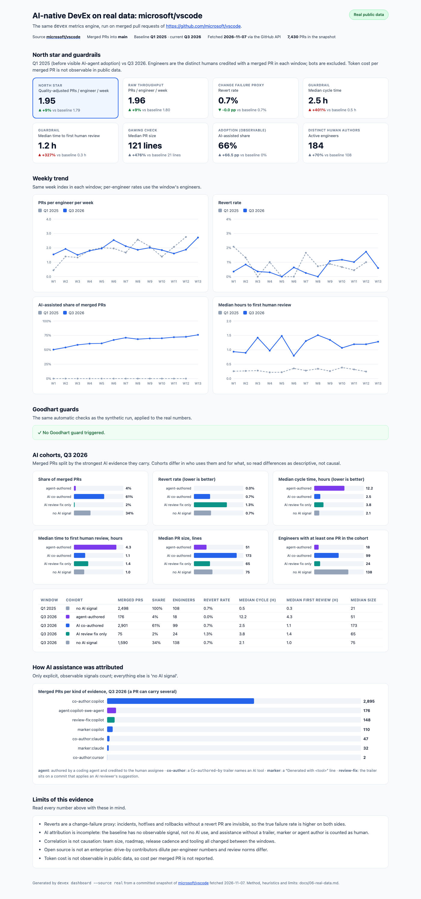

# 06 · Real data: microsoft/vscode

The synthetic dashboard shows what the metrics engine *should* reveal. This chapter runs the
same engine, unchanged, on real merged pull requests from
[microsoft/vscode](https://github.com/microsoft/vscode), so every claim about measurement can
be checked against public data.

[](dashboard-real.html)

## Why microsoft/vscode

- **Famous and high-volume.** One of the most active public repositories on GitHub: about
  2,500 merged PRs into `main` in Q1 2025 and 4,900 in Q3 2026, from a large core team.
- **AI assistance is visible, not guessed.** The repo uses the Copilot coding agent
  (`copilot-swe-agent` authors PRs; a human is assigned) and many commits carry
  `Co-authored-by: Copilot` trailers. That gives an observable adoption signal.
- **A clean before.** Verified before choosing it:

  | Merged into `main` | Q1 2025 | Q1 2026 | Q3 2026 |
  |---|---|---|---|
  | PRs | 2,512 | 4,177 | 4,906 |
  | PRs authored by `copilot-swe-agent` | 0 | 192 | 176 |
  | Commits with a `Co-authored-by: Copilot` trailer | 0 | 858 | 3,555 |

So the comparison is **Q1 2025** (2025-01-01 to 2025-04-01, before visible AI-agent adoption)
against **Q3 2026** (2026-07-01 to 2026-10-01, the latest complete quarter, at peak observable
adoption). Both are calendar quarters of 13 weeks.

## Method

```bash
devex fetch --repo microsoft/vscode --since 2025-01-01 --until 2025-04-01
devex fetch --repo microsoft/vscode --since 2026-07-01 --until 2026-10-01
devex report --source real       # the tables below
devex dashboard --source real    # docs/dashboard-real.html
```

1. **Fetch** ([`github_source.py`](../src/devex/github_source.py)). `gh api graphql` pages
   through `is:pr is:merged base:main` search results in 7-day slices (the search API caps
   at 1,000 results per query). Each PR brings its author, assignees, merger, labels, body,
   reviews, size and its last 30 commit messages. A second search covers the 28 days after
   each window for `revert` PRs, so late reverts of in-window PRs are still seen.
2. **Snapshot.** Each PR is reduced to a compact record together with the *evidence* behind every
   classification, and written to [`data/real/microsoft-vscode.json`](../data/real/microsoft-vscode.json)
   (7,430 PRs, ~1.5 MB, one PR per line). Tests, CI and the dashboard read only the snapshot:
   nothing needs the network or a token after the fetch.
3. **Map** to the existing `metrics.PullRequest` and score with the existing `scorecard`,
   `cohort_scorecards` and `gaming_signals`. No metric was changed for real data.

## Heuristics

Every rule is a named constant or a small pure function in `github_source.py`, with tests
on recorded fixtures.

| Field | Rule |
|---|---|
| Scope | Merged PRs into the default branch only. Cherry-picks to release branches would double-count work. |
| `ai_assisted` | Any explicit, observable signal: **agent** author (`copilot-swe-agent`, `devin-ai-integration`, `cursor`, `claude`, `chatgpt-codex-connector`, `google-labs-jules`, …); **co-author**: a `Co-authored-by` trailer in the PR body or its last 30 commits naming an AI tool (Copilot, Claude, Cursor, Codex, ChatGPT, Gemini, Devin, Aider, Jules, OpenHands, Windsurf); **marker**: "Generated with <tool>"; **label**: exactly `ai-generated`, `ai-assisted`, `copilot-generated` or `agent-generated` (vscode's area label `copilot` is a product area, not evidence). |
| Review fix | A Copilot trailer on a commit titled "Apply suggestion(s) from…" or "Potential fix for pull request finding" is kept apart as `review-fix`: the AI touched the change but did not write it. It counts as AI-assisted but forms its own cohort. |
| Author (engineer) | Agent PRs are credited to the **first human assignee** (who delegated and steered the agent), else to the human who merged it. Engineers in a window are the distinct humans credited with a merged PR. |
| Bots | Any other bot account (`dependabot`, `vs-code-engineering`, renovate, …) is `is_bot` and never counts as throughput: 14 PRs in Q1 2025, 164 in Q3 2026. |
| First review | Earliest review by a human who is not the PR's author. AI reviewers (`copilot-pull-request-reviewer`) are bots and skipped. |
| Change failure | A PR is `reverted` if a later merged PR **whose title leads with "revert"** references it ("Reverts #N", "revert owner/repo#N", or a PR URL in the same repo) and merges within 28 days. 17 PRs reverted in Q1 2025, 31 in Q3 2026. |
| Cycle time | PR created to merged. |
| Size | Additions plus deletions. |
| Token cost | Not observable in public data; reported as "not observable", never as zero. |

## Results

Verbatim output of `devex report --source real`:

### Real data: microsoft/vscode, Q1 2025 vs Q3 2026

Source: https://github.com/microsoft/vscode · merged PRs into `main` · fetched 2026-11-07 · 7,430 PRs in the snapshot.

| Metric | Q1 2025 | Q3 2026 | Change |
|---|---|---|---|
| Merged PRs | 2,498 | 4,742 | +90% |
| Active engineers | 108 | 184 | +70% |
| PRs / engineer / week | 1.80 | 1.96 | +9% |
| Quality-adjusted PRs / engineer / week | 1.79 | 1.95 | +9% |
| Revert rate (change failure proxy) | 0.7% | 0.7% | -0.0 pp |
| Median cycle time (h) | 0.5 | 2.5 | +401% |
| Median time to first human review (h) | 0.3 | 1.2 | +327% |
| Median PR size (lines) | 21 | 121 | +476% |
| AI-assisted share | 0% | 66% | +66.5 pp |
| Token cost per merged PR | not observable | not observable | n/a |

**AI cohorts** (cohort engineers are the distinct authors in that cohort)

| Window | Cohort | Merged PRs | Share | Engineers | Revert rate | Median cycle (h) | Median first review (h) | Median size |
|---|---|---|---|---|---|---|---|---|
| Q1 2025 | no AI signal | 2,498 | 100% | 108 | 0.7% | 0.5 | 0.3 | 21 |
| Q3 2026 | agent-authored | 176 | 4% | 18 | 0.0% | 12.2 | 4.3 | 51 |
| Q3 2026 | AI co-authored | 2,901 | 61% | 99 | 0.7% | 2.5 | 1.1 | 173 |
| Q3 2026 | AI review fix only | 75 | 2% | 24 | 1.3% | 3.8 | 1.4 | 65 |
| Q3 2026 | no AI signal | 1,590 | 34% | 138 | 0.7% | 2.1 | 1.0 | 75 |

**AI evidence on merged PRs, Q3 2026** (a PR can carry several)

| Evidence | PRs |
|---|---|
| `co-author:copilot` | 2,895 |
| `agent:copilot-swe-agent` | 176 |
| `review-fix:copilot` | 148 |
| `marker:copilot` | 110 |
| `co-author:claude` | 47 |
| `marker:claude` | 32 |
| `co-author:cursor` | 2 |

**Goodhart guards**
- None triggered.

**Limits**
- Reverts are a change-failure proxy: incidents, hotfixes and rollbacks without a revert PR are invisible, so the true failure rate is higher on both sides.
- AI attribution is incomplete: the baseline has no observable signal, not no AI use, and assistance without a trailer, marker or agent author is counted as human.
- Correlation is not causation: team size, roadmap, release cadence and tooling all changed between the windows.
- Open source is not an enterprise: drive-by contributors dilute per-engineer numbers and review norms differ.
- Token cost is not observable in public data, so cost per merged PR is not reported.

## What the real data says

- **Adoption is real and fast.** 0% to 66% of merged PRs carry an explicit AI signal, climbing
  from about 50% in the first week of Q3 2026 to 76% in the last. Almost all of it is
  `Co-authored-by: Copilot` trailers; the autonomous coding agent authors 4% of merged PRs.
- **Throughput per engineer barely moved: +9%.** Merged PRs nearly doubled (+90%), but so
  did the number of engineers credited (+70%). The headline "2x PRs" is mostly more people,
  not more output per person. This is the trap the north star is designed to avoid.
- **Quality held, by the only proxy available.** The revert rate is flat at 0.7%, and the
  AI co-authored cohort reverts no more than PRs with no AI signal (0.7% vs 0.7%). The
  agent-authored cohort had no reverts in 176 PRs, which is too few to conclude anything.
- **The work got bigger and slower to land.** Median PR size grew from 21 to 121 lines,
  median cycle time from 0.5 h to 2.5 h, and time to first human review from 0.3 h to 1.2 h.
  AI co-authored PRs are the largest (median 173 lines). Agent PRs wait longest for a human
  (4.3 h to first review, 12.2 h to merge). **Review is the new bottleneck**, as the
  architecture chapter argues.
- **No Goodhart guard fired.** PRs did not get split (they grew), and the change failure
  proxy did not worsen. The cost guard cannot fire because token cost is not observable.
  That is a gap the dashboard states, not a pass.

## Limits

- **Reverts are a weak change-failure proxy.** Incidents, hotfixes, rollbacks and fixes
  without a revert PR are invisible. Reverts pushed as direct commits, or without a PR
  reference, are missed. The true failure rate is higher on both sides.
- **AI attribution is incomplete.** The baseline has *no observable* signal, not *no* AI
  use: inline completions leave no trace. PRs with more than 30 commits are only scanned on
  their last 30. One user account, `vscodebot-pr` (7 PRs), opens Copilot co-authored PRs
  and is counted as a human engineer.
- **Correlation is not causation.** Team size, roadmap, release process and review
  norms changed between the windows. Q1 and Q3 also differ seasonally; adding Q1 2026
  with another `devex fetch` gives a year-on-year view.
- **Open source is not an enterprise.** Drive-by contributors dilute per-engineer numbers,
  core maintainers merge many small changes within minutes (the baseline median cycle time
  is 0.5 h),
  and incentives differ from an internal team.
- **Token cost is not observable.** The cost guardrail, central to the synthetic case, cannot
  be checked on public data.

## Reproduce or extend

```bash
gh auth login                                   # any account; public data only
devex fetch --repo microsoft/vscode --since 2026-01-01 --until 2026-04-01   # add a window
devex fetch --repo dotnet/runtime --since 2025-01-01 --until 2025-04-01     # another repo
devex report --source real --snapshot data/real/dotnet-runtime.json
```

`fetch` merges windows into the snapshot; reports compare the first window against the last.
