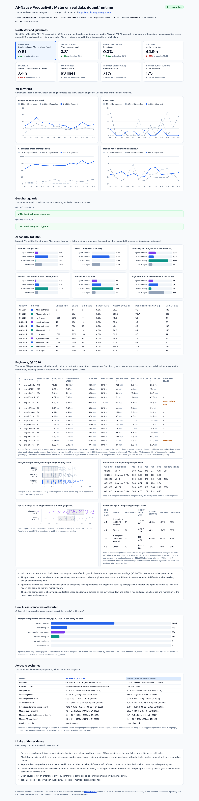

# 07 · A second repository: dotnet/runtime

One repository can be a fluke. This chapter runs the same engine, with the same windows,
heuristics, bot exclusion and revert proxy as [06 · Real data](06-real-data.md), on a second
famous public repository, [dotnet/runtime](https://github.com/dotnet/runtime), and puts the
two side by side.

[](dashboard-real-dotnet-runtime.html)

[Open the interactive dotnet/runtime dashboard](dashboard-real-dotnet-runtime.html). Each
real-data dashboard ends with the cross-repo table and links to the other one.

| Q3 2025 → Q3 2026 | dotnet/runtime | microsoft/vscode ([06](06-real-data.md)) |
|---|---|---|
| Merged PRs | 1,219 → 1,867 (+53%) | 3,216 → 4,735 (+47%) |
| Active engineers | 161 → 175 (+9%) | 157 → 183 (+17%) |
| PRs / engineer / week | 0.58 → 0.81 (+41%), +71% vs Q1 2025 | 1.56 → 1.97 (+26%), +9% vs Q1 2025 |
| AI-assisted share | 10% → 71% | 5% → 66% |
| Agent-authored share | 4% → 13% | 4% → 4% |
| Revert rate | 0.8% → 0.3% | 0.5% → 0.7% |
| Median PR size (lines) | 44 → 63 | 20 → 121 |
| Median time to first human review | 4.7 h → 7.4 h | 0.4 h → 1.2 h |
| Goodhart guards | none fired | none fired |

## Why dotnet/runtime

- **A different kind of codebase.** The .NET runtime and base class libraries: a large,
  long-lived C# and C++ codebase (JIT, garbage collector, libraries) with a strict review
  culture. microsoft/vscode is a TypeScript application that merges small changes fast.
- **A famous, public Copilot coding-agent rollout.** The agent authors PRs that maintainers
  are assigned to and review in the open, so adoption is observable, not guessed.
- **A different AI signature.** vscode's adoption shows up mostly as `Co-authored-by` trailers
  (the agent stays at about 4% of merged PRs). On dotnet/runtime the agent authors 13% of
  merged PRs in Q3 2026, on top of trailers.
- **Verified before fetching** (GitHub search, merged PRs):

  | Merged PRs | Q1 2025 | Q3 2025 | Q3 2026 |
  |---|---|---|---|
  | Into any branch | 1,357 | 1,566 | 2,338 |
  | **Into `main`** (what `devex` counts) | **1,118** | **1,271** | **1,927** |
  | Into `main`, authored by `copilot-swe-agent` | 0 | 44 | 234 |
  | Into `main`, authored by `dotnet-maestro` (dependency flow) | 66 | 39 | 24 |

  Commit search finds 1,123 commits with a `Co-authored-by: Copilot` trailer in Q3 2026.

## Same windows, same rules

- **Windows.** Q3 2026 is current, Q3 2025 the year-over-year baseline (headline), Q1 2025
  the pre-AI reference, exactly as for vscode. .NET ships once a year, in November, so both
  Q3 windows sit at the same point of the release cycle, the run-up to a release, and Q1 at
  the early-preview point. Q1 2025 is not perfectly clean here: 7 of 1,042 human PRs (1%)
  already carry a Copilot trailer.
- **`main` only.** dotnet/runtime also merges into `release/*` branches. Backports and
  servicing fixes there would double-count work, so they are excluded, as for vscode.
- **Bots.** GitHub Apps are bots by account type; here `dotnet-maestro` (dependency flow),
  `github-actions` and `dependabot` author merged PRs. Two automation *user* accounts were
  added to `AUTOMATION_LOGINS`: `dotnet-bot` and `dotnet-renovate-bot`. Excluded from
  throughput: 76 PRs in Q1 2025, 52 in Q3 2025 and 60 in Q3 2026. The list is explicit rather
  than a pattern, so a human maintainer whose login happens to contain "bot" is still counted.
- **Agent PRs credit a human.** All 278 merged `copilot-swe-agent` PRs (44 in Q3 2025, 234 in
  Q3 2026) are credited to a human assignee: 47 distinct engineers, none to the agent itself.
  In a sample of 40 Q3 2026 agent PRs, every one had a human assignee and in 38 the person
  who merged it was among the assignees.

The snapshot, [`data/real/dotnet-runtime.json`](https://github.com/talktorobson/ai-native-meter/blob/main/data/real/dotnet-runtime.json),
holds 4,325 PRs (about 1 MB): the 4,316 merged into `main` in the three windows, plus 9
later revert PRs that only serve to mark reverts.

## Repository consolidation check

vscode's year-over-year number was inflated until the baseline counted
microsoft/vscode-copilot-chat, whose code moved in ([06](06-real-data.md#repository-consolidation)).
The same check on dotnet/runtime finds no confounder of that size, so the baseline is
dotnet/runtime alone:

| Candidate | What happened | Merged PRs, Q3 2025 / Q3 2026 | Verdict |
|---|---|---|---|
| [dotnet/hotreload-utils](https://github.com/dotnet/hotreload-utils) | Its delta generator moved to `src/tools/hotreload-delta-gen` ("Merge hotreload-utils source into runtime repo", [dotnet/runtime#126512](https://github.com/dotnet/runtime/pull/126512), 2026-04-10). The repository is **not** archived and still merges PRs. | 38 / 16, of which 5 / 0 by humans | Not folded in: one tool moved, the repository lives on, and 5 human PRs are under 0.5% of runtime's baseline. |
| [dotnet/linker](https://github.com/dotnet/linker) | Moved into runtime in 2022, before every window. | 3 / 7 | Not a confounder. |
| `src/tools/ilasm` | New in the tree, but a C# rewrite written in runtime ([dotnet/runtime#122112](https://github.com/dotnet/runtime/pull/122112), 2025-12-15), not a move. | n/a | Not a move. |
| Other dotnet repositories archived since 2025 | None moved code into runtime. | n/a | None. |

## Results

Verbatim output of `devex report --source real --repo dotnet/runtime`:

### Real data: dotnet/runtime, Q3 2025 vs Q3 2026 (pre-AI reference Q1 2025)

Source: https://github.com/dotnet/runtime · merged PRs into `main` · fetched 2026-11-07 · 4,325 PRs in the snapshot.

| Metric | Q1 2025 (reference) | Q3 2025 (baseline) | Q3 2026 (current) | Q3 2026 vs Q3 2025 | Q3 2026 vs Q1 2025 |
|---|---|---|---|---|---|
| Merged PRs | 1,042 | 1,219 | 1,867 | +53% | +79% |
| Active engineers | 171 | 161 | 175 | +9% | +2% |
| PRs / engineer / week | 0.47 | 0.58 | 0.81 | +41% | +71% |
| Quality-adjusted PRs / engineer / week | 0.47 | 0.57 | 0.81 | +42% | +72% |
| Revert rate (change failure proxy) | 0.9% | 0.8% | 0.3% | -0.6 pp | -0.6 pp |
| Median cycle time (h) | 47.8 | 35.5 | 44.9 | +27% | -6% |
| Median time to first human review (h) | 7.3 | 4.7 | 7.4 | +58% | +2% |
| Median PR size (lines) | 48 | 44 | 63 | +43% | +31% |
| AI-assisted share | 1% | 10% | 71% | +60.9 pp | +70.4 pp |
| Token cost per merged PR | not observable | not observable | not observable | n/a | n/a |

**AI cohorts** (cohort engineers are the distinct authors in that cohort)

| Window | Cohort | Merged PRs | Share | Engineers | Revert rate | Median cycle (h) | Median first review (h) | Median size |
|---|---|---|---|---|---|---|---|---|
| Q1 2025 | AI co-authored | 6 | 1% | 6 | 0.0% | 28.5 | 0.5 | 132 |
| Q1 2025 | AI review fix only | 1 | 0% | 1 | 0.0% | 333.9 | 119.7 | 216 |
| Q1 2025 | no AI signal | 1,035 | 99% | 171 | 0.9% | 48.0 | 7.3 | 47 |
| Q3 2025 | agent-authored | 44 | 4% | 19 | 2.3% | 37.3 | 1.5 | 33 |
| Q3 2025 | AI co-authored | 63 | 5% | 30 | 0.0% | 49.1 | 5.2 | 103 |
| Q3 2025 | AI review fix only | 17 | 1% | 13 | 0.0% | 98.8 | 0.7 | 157 |
| Q3 2025 | no AI signal | 1,095 | 90% | 158 | 0.8% | 32.9 | 5.0 | 41 |
| Q3 2026 | agent-authored | 234 | 13% | 41 | 0.0% | 60.9 | 2.8 | 46 |
| Q3 2026 | AI co-authored | 1,048 | 56% | 81 | 0.4% | 43.8 | 8.1 | 80 |
| Q3 2026 | AI review fix only | 45 | 2% | 25 | 0.0% | 165.5 | 27.8 | 181 |
| Q3 2026 | no AI signal | 540 | 29% | 132 | 0.2% | 33.4 | 7.1 | 33 |

**AI evidence on merged PRs** (a PR can carry several)

| Evidence | Q1 2025 | Q3 2025 | Q3 2026 |
|---|---|---|---|
| `co-author:copilot` | 6 | 68 | 1,064 |
| `marker:copilot` | 0 | 0 | 273 |
| `agent:copilot-swe-agent` | 0 | 44 | 234 |
| `review-fix:copilot` | 1 | 20 | 147 |
| `co-author:claude` | 0 | 0 | 6 |
| `marker:claude` | 0 | 0 | 1 |

**Goodhart guards**
- Q3 2026 vs Q3 2025: none triggered.
- Q3 2026 vs Q1 2025: none triggered.

**Limits**
- Reverts are a change-failure proxy: incidents, hotfixes and rollbacks without a revert PR are invisible, so the true failure rate is higher on both sides.
- AI attribution is incomplete: a window with no observable signal is not a window with no AI use, and assistance without a trailer, marker or agent author is counted as human.
- Repositories change shape: code that moved in from another repository inflates a before/after comparison unless the baseline counts the old repository too.
- Correlation is not causation: team size, roadmap, release cadence and tooling all changed between the windows. Comparing the same quarter a year apart removes seasonality, nothing else.
- Open source is not an enterprise: drive-by contributors dilute per-engineer numbers and review norms differ.
- Token cost is not observable in public data, so cost per merged PR is not reported.

## Across repositories

Verbatim output of `devex compare` (every committed snapshot):

### Real data across repositories

Each cell is baseline → current (change; change vs the pre-AI reference). Rates change in percentage points, everything else relatively.

| Metric | [microsoft/vscode](https://github.com/microsoft/vscode) | [dotnet/runtime](https://github.com/dotnet/runtime) |
|---|---|---|
| Windows | Q3 2025 → Q3 2026 (reference Q1 2025) | Q3 2025 → Q3 2026 (reference Q1 2025) |
| Baseline counts | microsoft/vscode + microsoft/vscode-copilot-chat | dotnet/runtime |
| Merged PRs | 3,216 → 4,735 (+47%; +90% vs Q1 2025) | 1,219 → 1,867 (+53%; +79% vs Q1 2025) |
| Active engineers | 157 → 183 (+17%; +69% vs Q1 2025) | 161 → 175 (+9%; +2% vs Q1 2025) |
| PRs / engineer / week | 1.56 → 1.97 (+26%; +9% vs Q1 2025) | 0.58 → 0.81 (+41%; +71% vs Q1 2025) |
| AI-assisted share | 5% → 66% (+61.8 pp; +66.4 pp vs Q1 2025) | 10% → 71% (+60.9 pp; +70.4 pp vs Q1 2025) |
| Revert rate (change failure proxy) | 0.5% → 0.7% (+0.2 pp; -0.0 pp vs Q1 2025) | 0.8% → 0.3% (-0.6 pp; -0.6 pp vs Q1 2025) |
| Median cycle time (h) | 0.8 → 2.5 (+210%; +401% vs Q1 2025) | 35.5 → 44.9 (+27%; -6% vs Q1 2025) |
| Median time to first human review (h) | 0.4 → 1.2 (+195%; +327% vs Q1 2025) | 4.7 → 7.4 (+58%; +2% vs Q1 2025) |
| Median PR size (lines) | 20 → 121 (+505%; +476% vs Q1 2025) | 44 → 63 (+43%; +31% vs Q1 2025) |
| Goodhart guards | none triggered | none triggered |
| Token cost per merged PR | not observable | not observable |

## What differs, and why

Same engine, same windows, same rules. The two repositories still differ in language,
contributors, review culture and how AI help shows up, so **compare directions, not levels**:
dotnet/runtime's 0.81 PRs per engineer per week is not "less productive" than vscode's 1.97,
it is a codebase where a median PR takes 45 hours to land rather than 2.5.

- **Adoption lands in the same place by different routes.** Both reach about two thirds of
  merged PRs with an observable AI signal (vscode 66%, dotnet/runtime 71%). On vscode that is
  trailers on human PRs, and the agent stays at 4%. On dotnet/runtime the agent authors 13%
  (234 PRs credited to 41 engineers), and trailers cover another 56%. Its weekly share climbs
  from 55% to 81% across Q3 2026. Its baseline is less clean: 10% AI-assisted in Q3 2025,
  against 5% for vscode.
- **Throughput per engineer rises in both, more on dotnet/runtime, and the reason differs.**
  - dotnet/runtime: +41% year over year and +71% against Q1 2025, with headcount nearly flat
    (+9% and +2%). Here Q3 2025 is above Q1 2025, so the gain is not a soft baseline.
  - vscode: +26% year over year but only +9% against Q1 2025, because Q3 2025 was its weakest
    window and headcount grew (+17% and +69%).

  Both are correlations over a year in which roadmaps, teams and tools changed.
- **Quality held on both, by the only proxy available.** Revert rate 0.5% → 0.7% on vscode and
  0.8% → 0.3% on dotnet/runtime (10 reverted PRs, then 5). Neither shows degradation, and the
  counts are too small to claim an improvement. On dotnet/runtime, 234 agent PRs had no revert
  and AI co-authored PRs reverted at 0.4%.
- **Review absorbed the change differently.** On vscode, median PR size grew six-fold (20 → 121
  lines) and time to first human review tripled: review is its new bottleneck. On
  dotnet/runtime, PRs grew modestly (44 → 63 lines). Cycle time (+27%) and first review (+58%)
  rose year over year but are flat against Q1 2025 (−6%, +2%): Q3 2025 was the unusually fast
  window. That is consistent with a stricter review culture that keeps AI output in small PRs,
  but it does not prove it.
- **Agent PRs take longer to land on dotnet/runtime.** First human review is fast (2.8 h,
  versus 7.1 h with no AI signal), but the median cycle time is 60.9 h, against 33.4 h with no
  AI signal: agent PRs go through more rounds before merge.
- **No Goodhart guard fired on either repository**, against either earlier window.

## Limits

All the limits of [06](06-real-data.md#limits) apply. Specific to dotnet/runtime:

- **`main` only.** Servicing and backport work on `release/*` is invisible. If AI changed how
  much of it there is, these numbers do not show it.
- **Dependency flow is excluded** with the bots. `dotnet-maestro` PRs fell from 66 to 24 per
  quarter, so any human effort they triggered is not attributed either way.
- **Q1 2025 is "pre-AI" only by observable signal**, and here not quite: 1% of its PRs carry a
  Copilot trailer.
- **hotreload-utils is not folded in.** At most 5 human PRs in the baseline; folding them in
  would lower the year-over-year merged-PR gain by under one percentage point (+53% to about
  +52%).
- **Community contributors.** About 43% of each window's engineers merged a single PR, so
  per-engineer rates move with community activity as well as with the core team.

## Reproduce

```bash
devex fetch --repo dotnet/runtime --since 2025-01-01 --until 2025-04-01
devex fetch --repo dotnet/runtime --since 2025-07-01 --until 2025-10-01
devex fetch --repo dotnet/runtime --since 2026-07-01 --until 2026-10-01
devex report --source real --repo dotnet/runtime   # the tables above
devex compare                                      # both repositories, side by side
devex dashboard --source real                      # one page per committed snapshot
```
