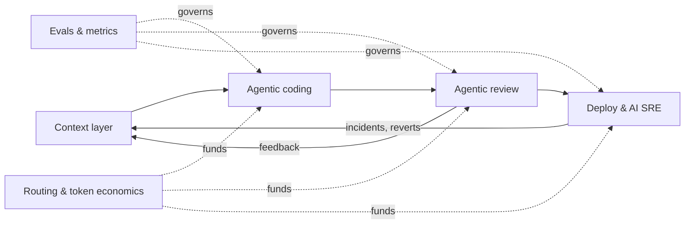

Every CTO wants AI to multiply engineering throughput; almost nobody has done it at scale.
This site makes the case for *why* it is worth solving, *why* it is still unsolved, and
*how* I would lead it, backed by small, tested code for the parts most programmes get wrong:
measurement, evals, context and cost.

> Context is the platform. Agents are applications. Evals are the governance.
> Routing is the economics.

## On real data: microsoft/vscode and dotnet/runtime

The same metrics engine, run on two famous public repositories with the same windows and
rules. The headline compares **Q3 2026 with Q3 2025**, the same quarter a year earlier, so
seasonality is controlled for; Q1 2025 is the pre-AI reference.

| Q3 2025 → Q3 2026 | [microsoft/vscode](https://github.com/microsoft/vscode) | [dotnet/runtime](https://github.com/dotnet/runtime) |
|---|---|---|
| Merged PRs | 3,216 → 4,735 (**+47%**) | 1,219 → 1,867 (**+53%**) |
| PRs / engineer / week | 1.56 → 1.97 (**+26%**), only **+9%** vs Q1 2025 | 0.58 → 0.81 (**+41%**), **+71%** vs Q1 2025 |
| AI-assisted share | **5% → 66%** of merged PRs | **10% → 71%** of merged PRs |
| Revert rate (change-failure proxy) | **0.5% → 0.7%**, flat within noise | **0.8% → 0.3%**, too few to call |
| Median PR size | 20 → 121 lines | 44 → 63 lines |
| Goodhart guards | none fired | none fired |

Compare directions, not levels: the codebases differ in language, contributors and review
culture. Reverts are only a proxy, attribution is incomplete, open source is not an
enterprise, and none of this is causal.

### microsoft/vscode

**10,670 real merged pull requests.** The Q3 2025 baseline counts vscode **plus**
[microsoft/vscode-copilot-chat](https://github.com/microsoft/vscode-copilot-chat), whose code
moved into vscode in 2026, so both windows cover the same code. Q3 2025 was vscode's weakest
quarter per engineer (1.56 against 1.80 in Q1 2025), so quote both gains. AI help shows up
mostly as Copilot co-author trailers, and review is the new bottleneck: time to first human
review 0.4 h → 1.2 h. Method, heuristics and limits are in [06 · Real data](06-real-data.md).
[Open the vscode dashboard](dashboard-real.html).

### dotnet/runtime

**4,325 real merged pull requests** from a large C# and C++ codebase with a strict review
culture. No repository moved in between the windows, so the baseline is dotnet/runtime alone.
The Copilot coding agent authors 13% of merged PRs (against about 4% on vscode), each
credited to the human assignee. The per-engineer gain comes with nearly flat headcount, and
review held its shape. Consolidation check, results and the cross-repo reading are in
[07 · A second repository](07-dotnet-runtime.md).
[Open the dotnet/runtime dashboard](dashboard-real-dotnet-runtime.html).

### Engineers, under pseudonyms

Take the engineers who merged in both Q3 2025 and Q3 2026. On dotnet/runtime, those with
at least half their PRs AI-assisted went from 0.61 → 1.07 PRs per week at the median, while
the others stayed at 0.38. The gap in median change is +89%, and its 90% interval excludes
zero.

On vscode the typical adopter gained no more than the others: the gap is -19% and its
interval spans zero. Pooled adopter output still rose 95%, so the gain sits with a few
prolific engineers; the top 10% merge 71% of PRs.

Each dashboard has a sortable engineer table with guardrail flags. Names are pseudonyms,
because individual numbers are for distribution and coaching, not leaderboards
([ADR-0005](adr/0005-individual-metrics-are-not-leaderboards.md)). See
[08 · Engineers](08-engineers.md).

## The target state, on synthetic data

[The KPI dashboard on synthetic data](dashboard.html) shows what public data cannot: token
cost, evals and routing. Every module's output is in [the demo output](demo-output.md).

### Token economics

Inside a company, AI spend can be metered per call and joined to the change it worked on. The
headline is then **cost per accepted change** (merged, not reverted), not cost per token. In
the synthetic demo, eval-driven routing and a shared prompt cache cut it from $7.30 to $2.32
while the org revert rate stayed within its guard. The one team that forced the smallest
model everywhere cut its cost to $0.29, saw its revert rate rise from 3.6% to 9.7%, and
tripped the "cheaper but worse" guard. On the public repositories these tiles are blank: PRs
do not reveal token spend. See [09 · Token economics](09-token-economics.md) and
[ADR-0006](adr/0006-cost-per-accepted-outcome.md).

## Read the case

| # | Document | In one line |
|---|---|---|
| 01 | [The case](01-the-case.md) | A ~USD 100M/year prize at 3,500 engineers, and six reasons it is still unsolved |
| 02 | [Metrics](02-metrics.md) | One north star, four guardrails, automatic Goodhart guards |
| 03 | [Architecture](03-architecture.md) | Context layer, agentic coding, agentic review, AI SRE, routing, platform |
| 04 | [Operating model](04-operating-model.md) | Turning borrowed, part-time contributors into a dedicated team, and the first 90 days |
| 05 | [Build vs partner](05-build-vs-partner.md) | Two-stage make / co-build / buy engine with priced lock-in, win probability and flip points |
| 06 | [Real data](06-real-data.md) | The same metrics on 10,670 PRs from microsoft/vscode: method, heuristics, results and limits |
| 07 | [A second repository](07-dotnet-runtime.md) | The same metrics on 4,325 PRs from dotnet/runtime, and both repositories side by side |
| 08 | [Engineers](08-engineers.md) | Per-engineer KPIs under pseudonyms: distribution, guardrails, and AI adopters vs others a year apart |
| 09 | [Token economics](09-token-economics.md) | Metering AI spend per call: schema, telemetry adapters, prices as data, and cost per accepted change |

### Decision records

- [ADR-0001 · Invest in the context layer before scaling agents](adr/0001-context-before-agents.md)
- [ADR-0002 · Optimise AI code review for precision before recall](adr/0002-precision-over-recall-in-review.md)
- [ADR-0003 · Route models by internal eval results, not by vendor benchmarks](adr/0003-route-by-evals.md)
- [ADR-0004 · Make build-vs-partner decisions as data, not as debate](adr/0004-decisions-as-data.md)
- [ADR-0005 · Individual metrics are for distribution and coaching, not leaderboards](adr/0005-individual-metrics-are-not-leaderboards.md)
- [ADR-0006 · Meter cost per accepted outcome, not per token](adr/0006-cost-per-accepted-outcome.md)

## Run it

The reference implementation is pure Python 3.11+ with no runtime dependencies and runs
offline. Source, tests and instructions are on
[GitHub: talktorobson/ai-native-meter](https://github.com/talktorobson/ai-native-meter).
