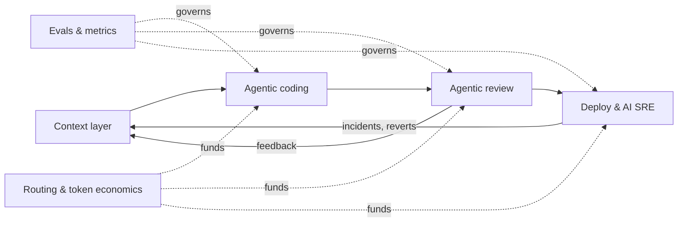
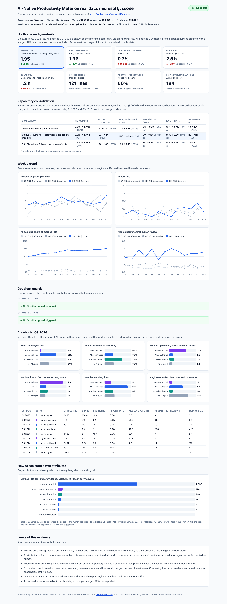

Every CTO wants AI to multiply engineering throughput; almost nobody has done it at scale.
This site makes the case for *why* it is worth solving, *why* it is still unsolved, and
*how* I would lead it, backed by small, tested code for the parts most programmes get wrong:
measurement, evals, context and cost.

> Context is the platform. Agents are applications. Evals are the governance.
> Routing is the economics.

## On real data: microsoft/vscode

The same metrics engine, run on **10,670 real merged pull requests** from
[microsoft/vscode](https://github.com/microsoft/vscode). The headline compares **Q3 2026 with
Q3 2025**, the same quarter a year earlier, so seasonality is controlled for. The Q3 2025
baseline counts vscode **plus** [microsoft/vscode-copilot-chat](https://github.com/microsoft/vscode-copilot-chat),
whose code moved into vscode in 2026, so both windows cover the same code.

| Q3 2025 → Q3 2026 | Result |
|---|---|
| Merged PRs | 3,216 → 4,742 (**+47%**) |
| PRs / engineer / week | 1.56 → 1.96 (**+26%**), only **+9%** vs the pre-AI Q1 2025 reference (1.80) |
| AI-assisted share | **5% → 66%** of merged PRs (0% in Q1 2025) |
| Revert rate (change-failure proxy) | **0.5% → 0.7%**, flat within noise |
| Review | Median PR size 20 → 121 lines, time to first human review 0.4 h → 1.2 h |

Review is the new bottleneck, and no Goodhart guard fired. Reverts are only a proxy,
attribution is incomplete, open source is not an enterprise, and none of this is causal:
method, heuristics and limits are in [06 · Real data](06-real-data.md).
[Open the interactive real-data dashboard](dashboard-real.html).

## The target state, on synthetic data

[The KPI dashboard on synthetic data](dashboard.html) shows what public data cannot: token
cost, evals and routing. Every module's output is in [the demo output](demo-output.md).

## Read the case

| # | Document | In one line |
|---|---|---|
| 01 | [The case](01-the-case.md) | A ~USD 100M/year prize at 3,500 engineers, and six reasons it is still unsolved |
| 02 | [Metrics](02-metrics.md) | One north star, four guardrails, automatic Goodhart guards |
| 03 | [Architecture](03-architecture.md) | Context layer, agentic coding, agentic review, AI SRE, routing, platform |
| 04 | [Operating model](04-operating-model.md) | Turning borrowed, part-time contributors into a dedicated team, and the first 90 days |
| 05 | [Build vs partner](05-build-vs-partner.md) | Two-stage make / co-build / buy engine with priced lock-in, win probability and flip points |
| 06 | [Real data](06-real-data.md) | The same metrics on 10,670 PRs from microsoft/vscode: method, heuristics, results and limits |

### Decision records

- [ADR-0001 · Invest in the context layer before scaling agents](adr/0001-context-before-agents.md)
- [ADR-0002 · Optimise AI code review for precision before recall](adr/0002-precision-over-recall-in-review.md)
- [ADR-0003 · Route models by internal eval results, not by vendor benchmarks](adr/0003-route-by-evals.md)
- [ADR-0004 · Make build-vs-partner decisions as data, not as debate](adr/0004-decisions-as-data.md)

## Run it

The reference implementation is pure Python 3.11+ with no runtime dependencies and runs
offline. Source, tests and instructions are on
[GitHub: talktorobson/ai-native-meter](https://github.com/talktorobson/ai-native-meter).
